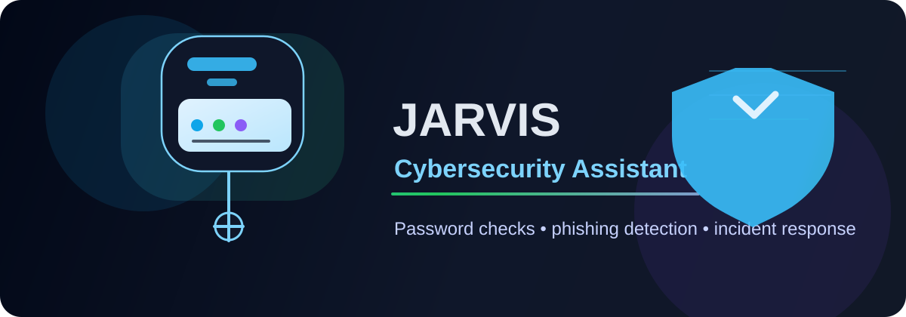

# jarvisprojects



This repository contains a cybersecurity chatbot named CYBERFRIDAY.

## What it does

- Checks password strength
- Identifies possible phishing indicators
- Reviews suspicious log entries
- Provides incident response guidance
- Can use an OpenAI-compatible API when configured

## Run locally

1. Create a virtual environment:

   ```bash
   python -m venv .venv
   source .venv/bin/activate
   ```

2. Install dependencies:

   ```bash
   pip install -r requirements.txt
   ```

3. Copy the environment template:

   ```bash
   cp .env.example .env
   ```

4. Add your OpenAI API key to `.env` if you want AI-powered responses.

5. Start the chatbot:

   ```bash
   python cybersecurity_chatbot.py
   ```

## Example usage

```text
You: hello
CYBERFRIDAY: Hello. I am CYBERFRIDAY, your cybersecurity assistant. Ask me about phishing, password strength, malware, or incident response.

You: password MyPassword123!
CYBERFRIDAY: Strong: Good length and complexity.

You: phishing Urgent! Your account will be suspended. Click here now to verify your credentials.
CYBERFRIDAY: Possible phishing attempt detected. Risk indicators: urgency language, credential harvesting language, potentially insecure URL...

You: report suspicious login attempts from multiple IPs across multiple accounts
CYBERFRIDAY: Incident response checklist:
1. Contain the affected system or user account.
2. Preserve logs, backups, and forensic evidence.
...
```

## Security best practices

- Use MFA on all important accounts.
- Patch systems regularly.
- Monitor login activity and access anomalies.
- Verify unexpected emails through trusted channels.
- Keep backups and limit privileged access.
